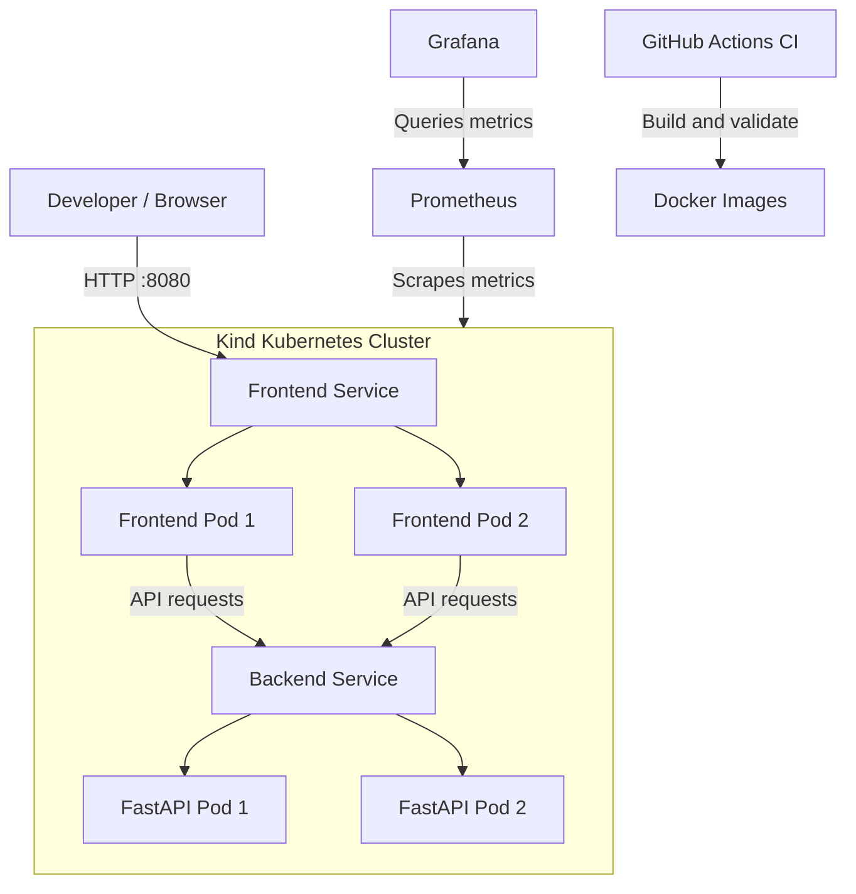

# KubeWatch — Kubernetes Deployment & Observability Platform

**Deploy. Monitor. Scale. Recover.**

KubeWatch is a containerized, full-stack application deployed on Kubernetes using **kind (Kubernetes in Docker)**. It combines a React dashboard, a FastAPI backend, Docker-based builds, Kubernetes Deployments and Services, GitHub Actions CI, and Prometheus + Grafana monitoring.

The project demonstrates practical DevOps and cloud-native engineering concepts, including containerization, declarative infrastructure, replica management, health checks, automated testing, security scanning, and observability.

---

## Project Overview

KubeWatch provides a web dashboard backed by a REST API and runs as multiple replicas inside a local Kubernetes cluster. Prometheus collects monitoring metrics, while Grafana provides dashboards for inspecting cluster and workload health.

### Key Features

- **Full-stack application:** React + Vite frontend and Python FastAPI backend.
- **Containerization:** Multi-stage Docker build for the frontend and a dedicated backend image.
- **Kubernetes orchestration:** Deployments, Services, namespace isolation, and multiple replicas.
- **Self-healing:** Kubernetes replaces failed pods to maintain the desired replica count.
- **Horizontal scaling:** Scale backend replicas using Kubernetes commands.
- **Health checks:** Backend health endpoint and Kubernetes health probes.
- **Observability:** Prometheus metrics collection and Grafana dashboards.
- **Automated CI:** GitHub Actions workflow for tests, security checks, frontend builds, and Docker image builds.
- **Security-conscious containers:** Non-root backend execution and dependency auditing.

## Architecture



*Note: The diagram represents the application and monitoring architecture. The frontend's API routing and monitoring targets depend on the configured manifests and service discovery.*

## Technology Stack

| Category | Technologies |
|---|---|
| Frontend | React, Vite, JavaScript, CSS |
| Backend | Python, FastAPI, Uvicorn |
| Containers | Docker, multi-stage builds |
| Orchestration | Kubernetes, kind |
| Networking | Kubernetes Services, Nginx reverse proxy |
| CI | GitHub Actions |
| Security | Bandit, pip-audit |
| Monitoring | Prometheus, Grafana, kube-state-metrics, Node Exporter |
| Local development | Windows PowerShell, Docker Desktop, kubectl, Helm |

## Repository Structure

```text
KubeWatch/
├── .github/
│   └── workflows/
│       └── ci.yml
├── backend/
│   ├── app/
│   │   └── main.py
│   ├── tests/
│   │   └── test_api.py
│   ├── Dockerfile
│   └── requirements.txt
├── frontend/
│   ├── src/
│   │   ├── App.jsx
│   │   ├── main.jsx
│   │   └── style.css
│   ├── index.html
│   ├── nginx.conf
│   ├── package.json
│   ├── vite.config.js
│   └── Dockerfile
├── k8s/
│   ├── namespace.yaml
│   ├── backend.yaml
│   ├── frontend.yaml
│   └── monitoring/
│       └── README.md
├── scripts/
│   └── kind-up.ps1
├── .gitignore
├── LICENSE
└── README.md
```

## Prerequisites

Install the following tools on your Windows machine:

- [Docker Desktop](https://www.docker.com/products/docker-desktop/) — running with the Linux container engine.
- [kind](https://kind.sigs.k8s.io/) — local Kubernetes clusters using Docker.
- [kubectl](https://kubernetes.io/docs/tasks/tools/) — Kubernetes command-line client.
- [Helm](https://helm.sh/docs/intro/install/) — required for the Prometheus and Grafana installation.
- [Git](https://git-scm.com/downloads) — source control.

Verify the installations in PowerShell:

```powershell
docker --version
kind version
kubectl version --client
helm version
git --version
```

Ensure Docker Desktop is running before creating the cluster.

## Quick Start — Deploy on kind

### 1. Clone the repository

Replace the placeholder with your GitHub repository URL.

```powershell
git clone https://github.com/YOUR_USERNAME/KubeWatch.git
cd KubeWatch
```

If you already have the project locally, open PowerShell in its existing directory instead.

### 2. Allow the setup script to run

```powershell
Set-ExecutionPolicy -Scope Process -ExecutionPolicy Bypass
```

This changes the execution policy only for the current PowerShell process.

### 3. Create the cluster and deploy the application

```powershell
.\scripts\kind-up.ps1
```

The script automates the local setup by creating the `kubewatch` kind cluster, building the frontend and backend Docker images, loading the images into the cluster, applying the Kubernetes manifests, waiting for deployment rollouts, and starting frontend port-forwarding.

Keep the terminal open if the script starts port-forwarding.

**Note:** The script has been used in the local setup described for this project. Run it on your own machine and inspect the output before claiming a fresh deployment is verified.

### 4. Access the application

| Component | URL |
|---|---|
| KubeWatch dashboard | http://localhost:8080 |
| Backend health endpoint through frontend | http://localhost:8080/api/health |
| Backend status endpoint through frontend | http://localhost:8080/api/api/status |

The status URL reflects the configured Nginx proxy rule, which strips the leading `/api/` prefix when forwarding requests to the backend.

If the frontend is not reachable, check the pod and service status before restarting anything.

## Kubernetes Operations

### Inspect the cluster

```powershell
kind get clusters
kubectl get nodes
kubectl get namespaces
```

### Inspect KubeWatch resources

```powershell
kubectl get pods -n kubewatch
kubectl get deployments -n kubewatch
kubectl get services -n kubewatch
kubectl get events -n kubewatch --sort-by=.lastTimestamp
```

The expected application layout is two frontend replicas and two backend replicas.

### Understand the Kubernetes resources

- **Namespace:** Groups the KubeWatch resources.
- **Deployment:** Maintains the desired number of frontend and backend replicas.
- **Pod:** Runs a containerized application instance.
- **Service:** Provides stable network access to a group of pods.
- **Readiness and liveness probes:** Help Kubernetes determine whether an application is ready or needs recovery.

### Demonstrate self-healing

First, identify the current backend pod names:

```powershell
kubectl get pods -n kubewatch
```

Delete one backend pod using its actual name:

```powershell
kubectl delete pod ACTUAL_BACKEND_POD_NAME -n kubewatch
```

Watch Kubernetes replace it:

```powershell
kubectl get pods -n kubewatch -w
```

Wait for the replacement pod to become ready, then press `Ctrl+C`.

This demonstrates the Deployment controller restoring the desired replica count.

### Demonstrate horizontal scaling

Scale the backend from two replicas to three:

```powershell
kubectl scale deployment kubewatch-backend --replicas=3 -n kubewatch
```

Verify the result:

```powershell
kubectl get deployments -n kubewatch
kubectl get pods -n kubewatch
```

Restore the original configuration:

```powershell
kubectl scale deployment kubewatch-backend --replicas=2 -n kubewatch
```

This is manual replica scaling, not automatic Horizontal Pod Autoscaler scaling.

## Monitoring with Prometheus and Grafana

KubeWatch can be monitored using the Prometheus community `kube-prometheus-stack` Helm chart. The stack includes Prometheus, Grafana, the Prometheus Operator, kube-state-metrics, Node Exporter, and Alertmanager.

### 1. Add the Helm repository

```powershell
helm repo add prometheus-community https://prometheus-community.github.io/helm-charts
helm repo update
```

### 2. Create the monitoring namespace

```powershell
kubectl create namespace monitoring
```

If the namespace already exists, continue without recreating it.

### 3. Install the monitoring stack

```powershell
helm install kube-prometheus-stack prometheus-community/kube-prometheus-stack `
  --namespace monitoring `
  --wait `
  --timeout 15m
```

The first installation can take several minutes because container images must be downloaded and started.

### 4. Verify monitoring resources

```powershell
kubectl get pods -n monitoring
kubectl get deployments,statefulsets -n monitoring
helm list -n monitoring
```

Wait for the relevant pods to become ready.

If Helm reports a timeout but the resources subsequently become ready, inspect the existing release before retrying:

```powershell
helm list -n monitoring
kubectl get pods -n monitoring
```

For a failed release that has already created resources, a recovery attempt may use:

```powershell
helm upgrade kube-prometheus-stack prometheus-community/kube-prometheus-stack `
  --namespace monitoring `
  --reuse-values `
  --wait `
  --timeout 15m
```

Inspect the release status afterward. Do not assume the upgrade succeeded until Helm reports the release as deployed.

### 5. Access Grafana

Start port-forwarding:

```powershell
kubectl port-forward -n monitoring service/kube-prometheus-stack-grafana 3001:80
```

Open [http://localhost:3001](http://localhost:3001).

Retrieve the generated admin password in a **second PowerShell terminal**:

```powershell
$encoded = kubectl get secret kube-prometheus-stack-grafana -n monitoring -o jsonpath="{.data.admin-password}"
[System.Text.Encoding]::UTF8.GetString([System.Convert]::FromBase64String($encoded))
```

Log in with:

- **Username:** `admin`
- **Password:** The decoded value printed by the command.

Keep the password private. If you change it in Grafana, the value stored in the Kubernetes Secret may no longer match.

### 6. Access Prometheus

In a separate terminal:

```powershell
kubectl port-forward -n monitoring service/kube-prometheus-stack-prometheus 9090:9090
```

Open [http://localhost:9090](http://localhost:9090).

Run this PromQL query:

```promql
up
```

A value of `1` indicates that the corresponding target is up.

### 7. Explore Grafana dashboards

The installed monitoring stack provisions Kubernetes dashboards automatically.

Useful dashboards include:

- Kubernetes / Compute Resources / Cluster
- Kubernetes / Compute Resources / Namespace (Pods)
- Kubernetes / Compute Resources / Namespace (Workloads)
- Kubernetes / Compute Resources / Node (Pods)
- Kubernetes / API server

Select the relevant dashboard and set the time range to **Last 15 minutes**. Where supported, filter by the `kubewatch` namespace.

These dashboards are intended to help inspect cluster resources, pod activity, and workload metrics. Actual data depends on the targets and metrics successfully collected by Prometheus.

### 8. Monitoring troubleshooting

Check the Grafana logs:

```powershell
kubectl logs deployment/kube-prometheus-stack-grafana -n monitoring --tail=100
```

Check Prometheus:

```powershell
kubectl logs prometheus-kube-prometheus-stack-prometheus-0 -n monitoring --tail=100
```

Inspect events:

```powershell
kubectl get events -n monitoring --sort-by=.lastTimestamp
```

Common issues include image downloads taking too long, insufficient Docker resources, failed readiness probes, and targets that are not being scraped.

## GitHub Actions CI

The workflow is located at:

```text
.github/workflows/ci.yml
```

It is intended to validate the application using automated checks such as:

1. Backend tests using pytest.
2. Python security analysis with Bandit.
3. Dependency vulnerability auditing with pip-audit.
4. Frontend production build.
5. Docker image builds for the application components.

The CI workflow does not automatically deploy to a cloud Kubernetes cluster simply because it builds Docker images. Publishing images to a registry and deploying them to a remote cluster are separate steps.

### Verify the workflow

Push the repository to GitHub and open the **Actions** tab.

Confirm the workflow has completed successfully before describing the pipeline as passing. If a job fails, use its logs to identify and resolve the problem.

## Run Backend Tests Locally

If Python is installed, create a virtual environment:

```powershell
cd backend

python -m venv .venv
.\.venv\Scripts\Activate.ps1

python -m pip install --upgrade pip
pip install -r requirements.txt

pytest -v
```

Return to the repository root when finished:

```powershell
cd ..
```

The backend test suite covers the API endpoints defined by the project. Use the actual pytest output to report the number of passing tests.

## Build Docker Images Manually

From the repository root:

```powershell
docker build -t kubewatch-backend:local ./backend
docker build -t kubewatch-frontend:local ./frontend
```

Verify the images:

```powershell
docker images kubewatch-backend
docker images kubewatch-frontend
```

The kind setup script handles loading the built images into the cluster. If you build images manually after deployment, rebuild and load them into kind before expecting Kubernetes pods to use the updated images.

## Troubleshooting

### Dashboard does not open

Check whether port-forwarding is running:

```powershell
kubectl get services -n kubewatch
kubectl get pods -n kubewatch
```

If needed, run:

```powershell
kubectl port-forward -n kubewatch service/kubewatch-frontend 8080:80
```

### Pods are not ready

```powershell
kubectl describe pods -n kubewatch
kubectl get events -n kubewatch --sort-by=.lastTimestamp
```

Check image errors, readiness probes, and scheduling events.

### API returns an error

```powershell
kubectl logs deployment/kubewatch-backend -n kubewatch --tail=100
```

Verify the frontend Nginx proxy configuration and confirm that the backend Service has ready endpoints.

### Grafana shows no dashboards

Clear the dashboard search field and filters. The `kube-prometheus-stack` chart provisions multiple Kubernetes dashboards automatically.

### Grafana dashboards show no data

Check that the Prometheus pod is ready and that the Prometheus data source is connected. Inspect the targets in the Prometheus interface and verify that the required metrics are being collected.

### Helm installation timed out

Inspect the actual resources first:

```powershell
helm list -n monitoring
kubectl get pods -n monitoring
kubectl get events -n monitoring --sort-by=.lastTimestamp
```

A Helm timeout does not always mean that all the deployed resources failed. Recover the existing release only after inspecting its current state.

## Security Considerations

- The backend container is configured to run as a non-root user.
- Bandit checks Python source for common security issues.
- pip-audit checks Python dependencies for known vulnerabilities.
- Kubernetes health probes help detect unhealthy application instances.
- Grafana credentials are stored in Kubernetes Secrets; keep them out of source control and public screenshots.
- Local kind deployment is a development environment, not a production security boundary.
- A production deployment would need additional controls such as TLS, authentication, secrets management, resource limits, network policies, and hardened access permissions.

## Future Improvements

Potential enhancements include:

- Automated image publishing to Docker Hub or a container registry.
- GitOps deployment using Argo CD.
- Horizontal Pod Autoscaler with suitable resource requests and metrics.
- Application-specific Prometheus metrics.
- Custom Grafana dashboards and alert rules.
- Persistent storage for monitoring data.
- Ingress and TLS configuration.
- Deployment to a managed Kubernetes platform such as Azure Kubernetes Service.
- Software supply-chain scanning and image signing.

## What This Project Demonstrates

KubeWatch brings together several practical DevOps skills:

- Containerizing a full-stack application.
- Deploying and operating workloads on Kubernetes.
- Managing replicas and demonstrating self-healing.
- Exposing services within a cluster.
- Integrating CI checks and security scanning.
- Collecting and visualizing infrastructure metrics.
- Diagnosing container startup, readiness, and Helm installation issues.

## Author

**Aditya Patro**

- GitHub: https://github.com/Adityaa2510
- Portfolio: https://huntwithadi.vercel.app/

## License

This project is distributed under the license specified in the repository's `LICENSE` file.
